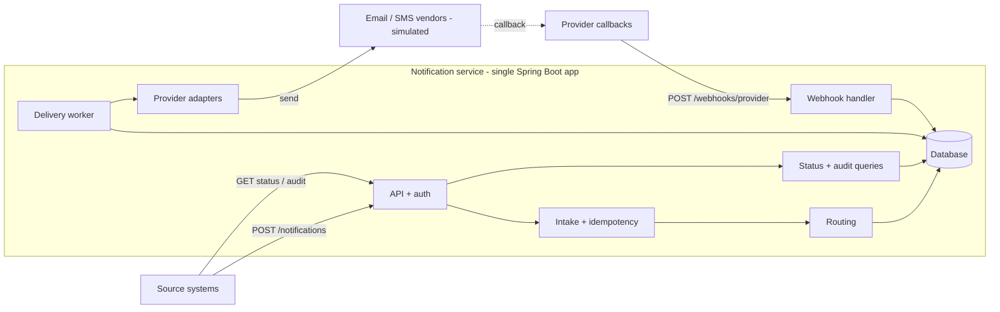
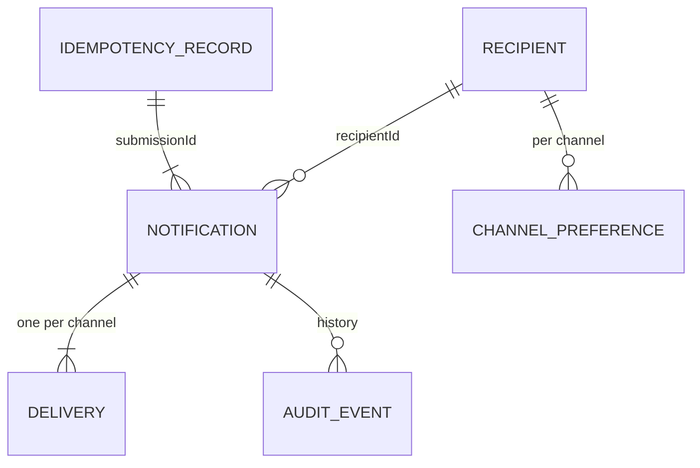
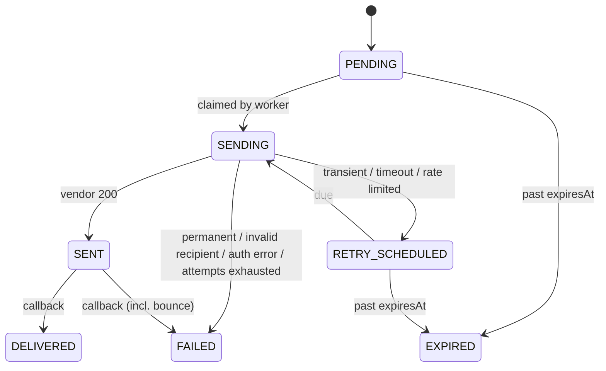
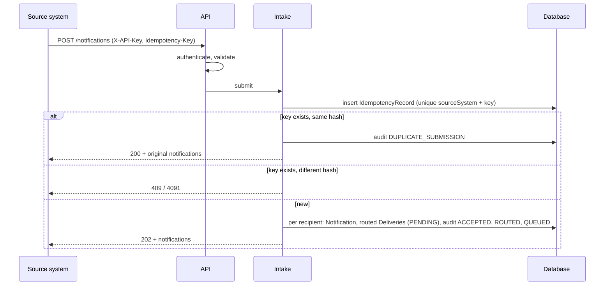
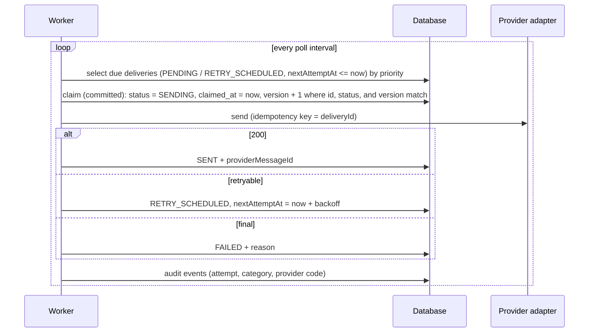
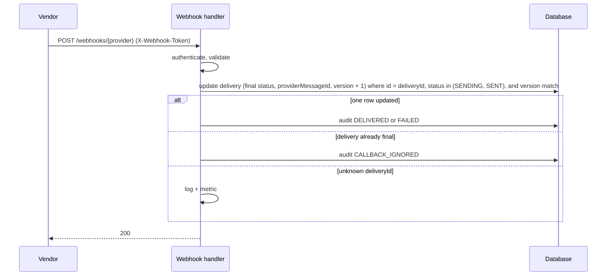

# Architecture

Notification Management Service: accepts notification requests from source systems, routes each recipient to channels, delivers asynchronously through providers, and tracks status through provider callbacks.

Decisions: `docs/adr/`. Assumptions: `docs/ambiguity-log.md`. Requirement IDs: `docs/requirements.md`.

## Components



| Component | Responsibility |
|---|---|
| API + auth | REST endpoints, validation, API-key and webhook-token auth, error mapping |
| Intake | Idempotency check, split request into one notification per recipient, persist |
| Routing | Resolve channels per recipient from request, preferences, and policy |
| Delivery worker | Claim due deliveries, call provider, classify result, schedule retries, expire |
| Provider adapters | One per channel: send call, error classification, callback event mapping |
| Webhook handler | Authenticate callback, dedupe, apply final status |
| Status + audit | Read models; overall status derived on read |
| Directory | Seeded recipients, contact addresses, channel preferences |

## API

All endpoints are under `/api/v1`. Callers authenticate with `X-API-Key` (ADR-0001). A source system can only read its own notifications.

| Method | Path | Purpose |
|---|---|---|
| POST | `/notifications` | Submit a notification for 1..100 recipients |
| GET | `/notifications/{id}` | Status of one notification (one recipient) |
| GET | `/notifications/{id}/audit` | Audit history of one notification |
| POST | `/webhooks/{provider}` | Provider delivery callbacks (`X-Webhook-Token`) |
| GET | `/actuator/health`, `/actuator/prometheus` | Operations |

### Submit

Headers: `X-API-Key` (required), `Idempotency-Key` (required).

```json
{
  "eventId": "evt-778",
  "type": "FRAUD_ALERT",
  "severity": "CRITICAL",
  "priority": "HIGH",
  "recipients": [
    { "userId": "user1", "channels": ["SMS"] },
    { "userId": "user2", "channels": ["EMAIL"] },
    { "userId": "user3" }
  ],
  "subject": "Suspicious login",
  "body": "We noticed a login from a new device.",
  "scheduledAt": null,
  "expiresAt": "2026-10-21T10:00:00Z"
}
```

- Required (spec 4.1): `eventId`, `type`, `severity` (INFO, WARNING, CRITICAL), `priority` (LOW, NORMAL, HIGH), `recipients`, `subject`, `body`. Optional: `scheduledAt`, `expiresAt`, per-recipient `channels`. No server-side defaults for spec fields.
- `severity` drives routing; `priority` drives worker claim order under backlog.
- Each recipient carries its own optional `channels`. When absent, the recipient's enabled channels from the directory are used. Contact addresses always come from the directory, never the request.
- One notification is created per recipient. All notifications from one request share an internal `submissionId` (not exposed).
- `202` on a new submission, `200` on an idempotent replay (same key, same payload) with the same body.

```json
{
  "notifications": [
    { "recipientId": "user1", "notificationId": "6f1c...", "status": "ACCEPTED" },
    { "recipientId": "user2", "notificationId": "a83d...", "status": "ACCEPTED" }
  ]
}
```

### Status

```json
{
  "notificationId": "6f1c...",
  "recipientId": "user1",
  "eventId": "evt-778",
  "type": "FRAUD_ALERT",
  "severity": "CRITICAL",
  "overallStatus": "PARTIALLY_DELIVERED",
  "duplicateSubmissions": 1,
  "createdAt": "...", "scheduledAt": null, "expiresAt": "...",
  "deliveries": [
    { "channel": "EMAIL", "status": "DELIVERED", "attempts": 2, "sentAt": "...", "finalizedAt": "..." },
    { "channel": "SMS", "status": "FAILED", "reason": "INVALID_RECIPIENT", "attempts": 1, "finalizedAt": "..." }
  ]
}
```

### Audit

```json
{
  "events": [
    { "at": "...", "type": "ACCEPTED" },
    { "at": "...", "type": "ROUTED", "channel": "SMS", "detail": "added: severity CRITICAL" },
    { "at": "...", "type": "ATTEMPT_FAILED", "channel": "EMAIL", "detail": "TRANSIENT, attempt 1" },
    { "at": "...", "type": "RETRY_SCHEDULED", "channel": "EMAIL", "detail": "in 2s" },
    { "at": "...", "type": "DUPLICATE_SUBMISSION", "detail": "same Idempotency-Key; original returned" },
    { "at": "...", "type": "DELIVERED", "channel": "EMAIL" }
  ]
}
```

### Provider callbacks

One generic callback format for all simulated providers. We pass our `deliveryId` with every send (real vendors support this: SendGrid custom args, Twilio per-message callback URL), so callbacks match on our own id.

`POST /webhooks/{provider}`, header `X-Webhook-Token`:

```json
{ "deliveryId": "d-5e1...", "providerMessageId": "em-123", "event": "BOUNCED", "reasonCode": "MAILBOX_UNAVAILABLE", "occurredAt": "..." }
```

- `event`: `DELIVERED`, `BOUNCED`, `FAILED`. `BOUNCED` maps to delivery `FAILED` with reason `BOUNCED`.
- Dedupe by state: only a `SENT` delivery changes. Repeats and late events for final deliveries are audited as `CALLBACK_IGNORED`.
- Response `200` with no body for applied and ignored events, so vendors do not retry. Unknown `deliveryId`: `200`, logged and counted.
- Mapping real vendor payloads (event names, batching, signatures) is production work inside each provider adapter.

### Errors

Every error, including authentication failures raised before any controller, uses one body (`Content-Type: application/problem+json`; all RFC 9457 members are optional, so this stays compliant):

```json
{
  "traceId": "8f3c2a1b9d",
  "errors": [
    { "code": 4001, "field": "Idempotency-Key", "message": "Required header is missing" },
    { "code": 4004, "field": "recipients[2].userId", "message": "Must not be blank" }
  ]
}
```

- All validation errors are returned together.
- Submitted values are never echoed back.
- `code` is a stable contract shared across subsystems; `message` may change.

| Code | HTTP | Meaning |
|---|---|---|
| 4001 | 400 | Required header missing |
| 4002 | 400 | Malformed JSON |
| 4003 | 400 | Invalid field value or type |
| 4004 | 400 | Required field missing |
| 4005 | 400 | Too many recipients (max 100) |
| 4011 | 401 | API key or webhook token missing |
| 4012 | 401 | API key or webhook token invalid |
| 4041 | 404 | Notification not found (also returned for another source system's notification) |
| 4091 | 409 | Idempotency key reused with a different payload |
| 4151 | 415 | Unsupported content type |
| 4221 | 422 | `expiresAt` is in the past |
| 4222 | 422 | `scheduledAt` is after `expiresAt` |
| 4223 | 422 | Unknown recipient (whole request rejected, every unknown recipient listed) |
| 5000 | 500 | Internal error (no detail, `traceId` only) |

## Data model



Conventions: timestamps are UTC instants; persisted timestamps come from an injected `Clock` truncated to microseconds (database precision); ids exposed by the API are UUIDs (not guessable or enumerable); internal tables use identity keys; enums are stored as strings.

### Directory (seeded, read-only)

`recipient`: the only table holding contact details.

| Column | Type | Notes |
|---|---|---|
| `id` | varchar(64) PK | Caller's user id |
| `email` | varchar(254) null | |
| `phone` | varchar(20) null | E.164 |

`channel_preference`

| Column | Type | Notes |
|---|---|---|
| `recipient_id`, `channel` | PK | |
| `enabled` | boolean | `false` = opted out |

A missing preference row means **enabled** (opt-out model, usual for transactional alerts). A channel is usable only if enabled and the recipient has an address for it.

#### Simulated outcomes (seeded addresses)

The simulated providers derive the outcome from the address, so every path is reproducible from a seeded recipient. Seeds are synthetic (`sim.test`, fictional `+1555010...` numbers) and live in Flyway `V2__seed_directory.sql`.

- Email: `<send>.<callback>@sim.test`, e.g. `timeout.delivered@sim.test`
- SMS: `+1555010SSCC`, SS = send code, CC = callback code, e.g. `+15550100200`

| Send | Email token | SMS `SS` | Send result |
|---|---|---|---|
| Accepted | `ok` | `00` | `SENT` |
| `TRANSIENT` | `transient` | `01` | Fails every attempt; retried until exhausted (`FAILED`) or `EXPIRED` |
| `TIMEOUT` | `timeout` | `02` | Fails every attempt; retried until exhausted (`FAILED`) or `EXPIRED` |
| `RATE_LIMITED` | `ratelimit` | `03` | Fails every attempt; retried until exhausted (`FAILED`) or `EXPIRED` |
| `PERMANENT_REJECTION` | `reject` | `04` | `FAILED` |
| `INVALID_RECIPIENT` | `invalid` | `05` | `FAILED` |
| `AUTH_ERROR` | `autherror` | `06` | `FAILED` |
| Fail twice, then accept | `flaky2` | `12` | Two `TRANSIENT` failures, then `SENT` |

| Callback (after `SENT`) | Email token | SMS `CC` |
|---|---|---|
| `DELIVERED` | `delivered` | `00` |
| `BOUNCED` (delivery `FAILED`) | `bounce` | n/a (SMS has no bounce) |
| `FAILED` | `failed` | `02` |
| No callback (stays `SENT`) | `silent` | `09` |

Seeded recipients:

| Id | Email (@sim.test) | Phone | Shows |
|---|---|---|---|
| `user-ok` | `ok.delivered` | `+15550100000` | Both channels, happy path (no preference rows) |
| `user-email-only` | `ok.delivered` | none | Email only |
| `user-sms-optout` | `ok.delivered` | `+15550100000` | SMS opted out (`enabled = false`), email explicitly enabled |
| `user-transient`, `user-timeout`, `user-ratelimit`, `user-reject`, `user-invalid`, `user-autherror`, `user-flaky2` | `<token>.delivered` | `+1555010<SS>00` | One per send outcome, both channels |
| `user-bounce` | `ok.bounce` | none | Bounce callback |
| `user-cb-failed` | `ok.failed` | `+15550100002` | Failed callback |
| `user-silent` | `ok.silent` | `+15550100009` | No callback |

### Intake

`idempotency_record`

| Column | Type | Notes |
|---|---|---|
| `id` | bigint PK | |
| `source_system`, `idempotency_key` | varchar(64), varchar(128) | Unique together. Longer keys rejected (4003) |
| `request_hash` | char(64) | SHA-256 of the canonical parsed request (not raw bytes, so whitespace and key order do not cause false conflicts) |
| `submission_id` | uuid | Links to the notifications created |
| `created_at`, `expires_at` | timestamp | Lookups ignore expired rows; `expires_at` indexed for the purge job (7 days) |

`notification`: one per recipient.

| Column | Type | Notes |
|---|---|---|
| `id` | uuid PK | Returned as `notificationId` |
| `submission_id` | uuid, indexed | Groups notifications from one request |
| `source_system` | varchar(64) | From the API key; used for tenant-scoped reads |
| `event_id`, `type` | varchar(128), varchar(64) | |
| `severity`, `priority` | varchar(16) | Required (spec 4.1) |
| `recipient_id` | FK `recipient` | |
| `requested_channels` | varchar(64) null | As requested, e.g. `SMS,EMAIL`; null = preferences. Explains requested vs selected |
| `subject`, `body` | varchar(200), varchar(5000) | Sensitive; stored only here, plaintext in the prototype |
| `scheduled_at`, `expires_at` | timestamp null | |
| `created_at` | timestamp | |

No status column: overall status is derived from deliveries.

### Delivery

`delivery`: one per (notification, channel); the worker's unit of work.

| Column | Type | Notes |
|---|---|---|
| `id` | uuid PK | Also the provider idempotency key |
| `notification_id`, `channel` | FK, varchar(16) | Unique together |
| `provider` | varchar(32) | e.g. `sim-email`; separate from channel so providers can change per channel |
| `status` | varchar(20) | `PENDING`, `SENDING`, `RETRY_SCHEDULED`, `SENT`, `DELIVERED`, `FAILED`, `EXPIRED` |
| `priority` | smallint | Copied from the notification (HIGH=0, NORMAL=1, LOW=2) so the poll sorts correctly without a join |
| `routing_reason` | varchar(32) | `REQUESTED`, `PREFERENCE`, `SEVERITY_ESCALATION` |
| `attempt_count` | int | |
| `next_attempt_at` | timestamp null | Due time; null once final. Index `(status, priority, next_attempt_at)` serves the poll |
| `claimed_at` | timestamp null | Lease start. Used only for the reclaim range check (`claimed_at < now - lease`) |
| `provider_message_id` | varchar(128) null | Set on `SENT`; unique with `provider` |
| `failure_reason` | varchar(32) null | Error category or callback reason, e.g. `INVALID_RECIPIENT`, `BOUNCED`, `RETRIES_EXHAUSTED` |
| `sent_at`, `finalized_at`, `created_at`, `updated_at` | timestamp | |
| `version` | bigint | Concurrency token. Every claim, outcome, and callback write is conditional on `id`, expected `status`, and `version`, and increments `version` and sets `updated_at` |

### Audit

`audit_event`: append-only; code never updates or deletes.

| Column | Type | Notes |
|---|---|---|
| `id` | bigint PK | |
| `source_system` | varchar(64) | |
| `notification_id` | uuid null, indexed | Null for `REJECTED` requests (spec 4.9). Only authenticated requests are audited; written in its own transaction because the submission rolled back |
| `delivery_id` | uuid null | |
| `type` | varchar(32) | `ACCEPTED`, `REJECTED`, `DUPLICATE_SUBMISSION`, `ROUTED`, `ROUTE_REMOVED`, `NOT_ROUTED`, `QUEUED`, `ATTEMPT_FAILED`, `RETRY_SCHEDULED`, `SENT`, `DELIVERED`, `FAILED`, `EXPIRED`, `CALLBACK_IGNORED` |
| `channel` | varchar(16) null | |
| `detail` | varchar(256) null | Codes and reasons only (attempt number, error category, provider code); never content or addresses. Replaces a separate attempts table |
| `occurred_at` | timestamp | |

API keys and webhook tokens are configuration, not tables (ADR-0001). Production path for content: encryption at rest and clearing `body` once all deliveries are final.

## Routing

Resolved per notification (one recipient):

1. Candidates: the recipient's `channels` from the request if given, else the recipient's enabled channels.
2. Remove channels the recipient opted out of, and channels with no contact address.
3. Apply policy from config, e.g. `CRITICAL` adds `SMS`. In greenfield an opt-out always wins over policy (revisited in the ambiguous scenario, A-30).
4. Each remaining channel becomes a `Delivery`. Every add and remove is audited with a reason.
5. No channel left: no deliveries, overall status `NOT_ROUTED`.

## Delivery lifecycle

Two-phase: a vendor `200` means accepted (`SENT`); the final outcome arrives by callback (ADR-0003).



- `SENT` with no callback stays `SENT` indefinitely. That is the honest state.
- After `SENT` nothing is resent; the vendor owns its own retries.
- Final states never change. Late or duplicate callbacks are ignored and audited.
- A claim that crashed after the vendor returned 200 but before `SENT` was written is resent on reclaim; the vendor dedupes on `deliveryId`. If it has since expired it is marked `EXPIRED` even though it may have been sent (documented limitation).

### Failure classification (send call)

| Category | Example | Action |
|---|---|---|
| `TRANSIENT` | 5xx, connection reset | Retry with backoff |
| `TIMEOUT` | No response in time | Retry with backoff; same provider idempotency key (`deliveryId`) |
| `RATE_LIMITED` | 429 | Retry after `Retry-After`, else backoff |
| `PERMANENT_REJECTION` | Vendor refuses content | `FAILED` |
| `INVALID_RECIPIENT` | Bad address or number | `FAILED` |
| `AUTH_ERROR` | Vendor rejects our credentials | `FAILED`, error log, metric (config problem, not delivery problem) |

Retries: max 4 attempts (configurable), exponential backoff with full jitter. If the next attempt would fall after `expiresAt`, the delivery becomes `EXPIRED`. Attempts exhausted: `FAILED` with reason `RETRIES_EXHAUSTED`.

### Overall status (derived on read)

| Deliveries | `overallStatus` |
|---|---|
| Before `scheduledAt` | `SCHEDULED` |
| Any `PENDING`, `SENDING`, `RETRY_SCHEDULED` | `IN_PROGRESS` |
| Otherwise any `SENT` | `AWAITING_CONFIRMATION` |
| All `DELIVERED` | `DELIVERED` |
| Some `DELIVERED`, rest failed or expired | `PARTIALLY_DELIVERED` |
| None delivered, all `EXPIRED` | `EXPIRED` |
| None delivered, otherwise | `FAILED` |
| No deliveries | `NOT_ROUTED` |

"Delivered" means every routed channel was delivered, not "recipient reached on some channel" (A-22).

## Control flow

### Submit



One transaction per submission: the idempotency record and all notifications commit together or not at all. The idempotency record is flushed first; a concurrent duplicate surfaces as a unique-key violation, handled outside the failed transaction by re-reading and replaying. Validation failures after authentication are audited as `REJECTED` in a separate transaction. "One key, one outcome" applies to accepted submissions: rejections are not stored, so a corrected retry with the same key can succeed.

### Deliver



- One single-threaded poller. Each claim is a conditional update committed before the send, so two workers can never send the same delivery.
- Every claim, outcome, and callback write is conditional on `id`, expected `status`, and `version`, and increments `version` and sets `updated_at`. Zero rows updated means another writer won. A slow worker whose lease was reclaimed cannot overwrite the newer state: the reclaim bumped `version`.
- `claimed_at` is used only for the lease reclaim range check (`claimed_at < now - lease`), never as a token.
- The lease is longer than the provider timeout. A delivery stuck in `SENDING` past the lease (crash mid-send) becomes claimable again; the resend reuses the same provider idempotency key.

### Callback



The delivery row is committed as `SENDING` before the send call, so even a callback that beats our `SENT` write finds it and applies the final status. The worker's later `SENT` write is conditional on `status = SENDING` and the claim's `version`, so it updates nothing and the final state stands.

## Security

- Source systems: hashed, rotatable API keys; `sourceSystem` comes from the key, never the body (ADR-0001).
- Webhooks: shared secret token per provider in `X-Webhook-Token`, checked the same way. Production: verify each vendor's own signature (ADR-0003).
- Tenant isolation: reads are scoped to the caller's source system; other ids return 404.
- Input limits: max 100 recipients, bounded `subject` and `body` length, enum validation, request size limit.
- Sensitive data: message content and contact details never appear in logs, audit events, or error bodies. Audit and logs reference ids only.
- Secrets come from environment variables; nothing secret is committed.
- Actuator exposes only `health`, `info`, `prometheus`. The H2 console is off outside the `dev` profile.

## Operations

| Signal | Detail |
|---|---|
| Trace id | Generated per request (or taken from `traceparent`), in MDC, logs, `X-Trace-Id` response header, and error bodies |
| Logs | Structured JSON (Spring Boot `logging.structured.format.console`); ids and outcome categories only |
| Health | `/actuator/health` (database, worker liveness) |
| Metrics | `nms.deliveries.outcome{channel,status}`, `nms.delivery.attempts{channel,category}`, `nms.deliveries.due` (backlog gauge) |

What to alert on:
- `AUTH_ERROR` from a provider: our credentials are wrong; every delivery on that channel will fail.
- Growing `nms.deliveries.due`: workers are not keeping up or a provider is down.
- Warnings for unknown-delivery or rejected webhook calls: misconfiguration or forged callbacks.

## Scaling path (not built)

| Concern | Prototype | Production |
|---|---|---|
| Database | H2 | PostgreSQL |
| Work claiming | Conditional update on `id`, `status`, and `version` | `SELECT ... FOR UPDATE SKIP LOCKED`, or a broker (Kafka/SQS) with the database as outbox |
| Throughput | One instance, single-threaded poller | Horizontal instances; per-channel worker pools |
| Provider limits | Retry on 429 | Token bucket per provider |
| Auth | Hashed API keys in config | HMAC request signing or JWT; secrets manager |
| Retention | Idempotency purge job | Partitioned audit tables, archival |

## Out of scope

Cancel, list/search, preferences API, templates and localization, engagement events (open/click), quiet hours, bulk sends above 100 recipients, real vendor integrations.
