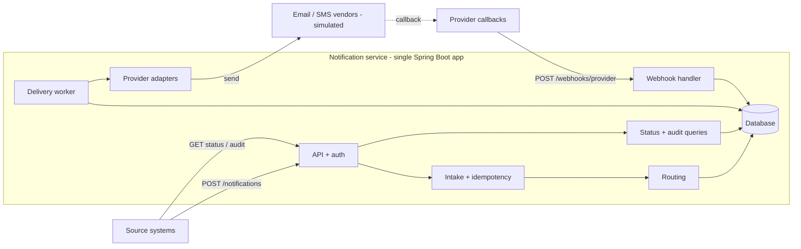
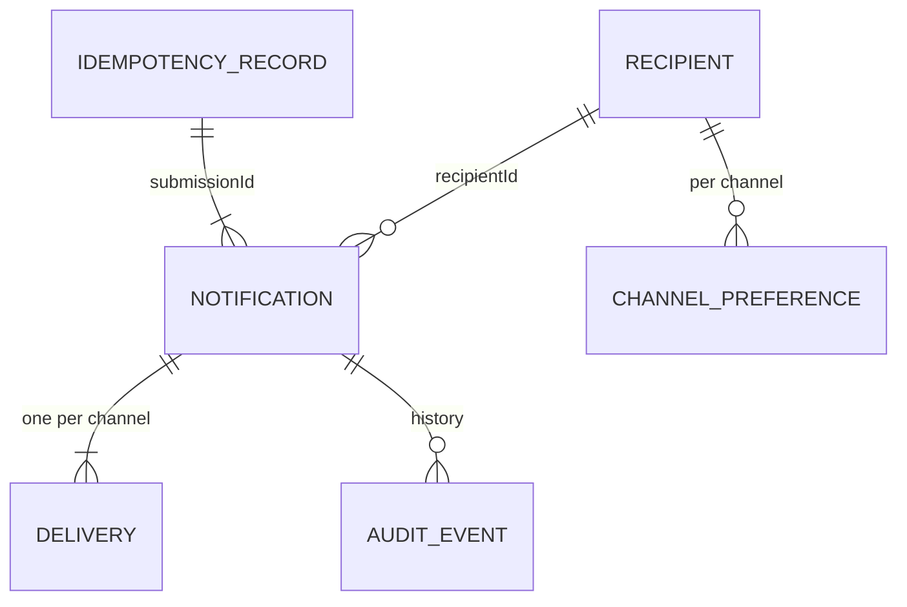
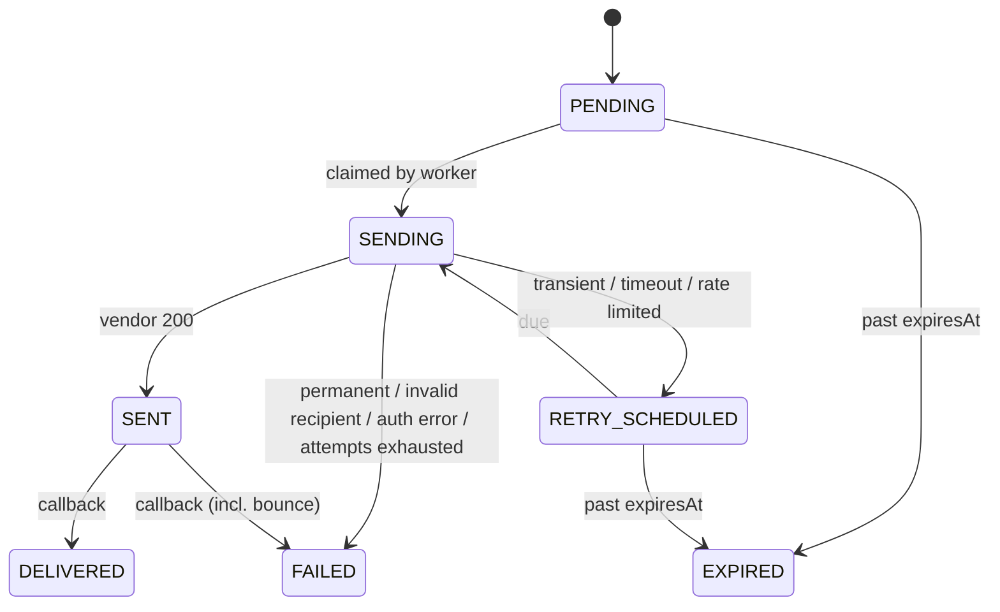
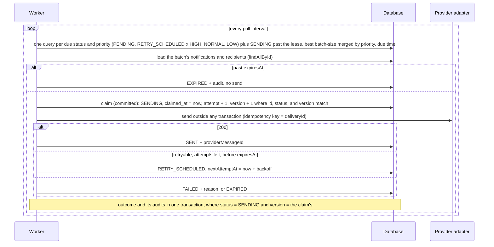
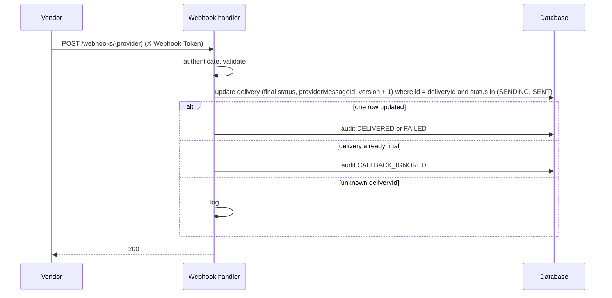

# Architecture

Notification Management Service: accepts notification requests from source systems, routes each recipient to channels, delivers asynchronously through providers, and tracks status through provider callbacks.

Decisions: `docs/adr/`. Assumptions: `docs/ambiguity-log.md`. Requirement IDs: `docs/requirements.md`.

## Components



| Component | Responsibility |
|---|---|
| API + auth | REST endpoints, validation, API-key and webhook-token auth, error mapping |
| Intake | Idempotency check, split request into one notification per recipient, persist |
| Routing | Resolve channels per recipient from request, preferences, and policy |
| Delivery worker | Claim due deliveries, call provider, classify result, schedule retries, expire |
| Provider adapters | One per channel: send call, error classification, callback event mapping |
| Webhook handler | Authenticate callback, dedupe, apply final status |
| Status + audit | Read models; overall status derived on read |
| Directory | Seeded recipients, contact addresses, channel preferences |

## API

All endpoints are under `/api/v1`. Callers authenticate with `X-API-Key` (ADR-0001). A source system can only read its own notifications.

| Method | Path | Purpose |
|---|---|---|
| POST | `/notifications` | Submit a notification for 1..100 recipients |
| GET | `/notifications/{id}` | Status of one notification (one recipient) |
| GET | `/notifications/{id}/audit` | Audit history of one notification |
| POST | `/webhooks/{provider}` | Provider delivery callbacks (`X-Webhook-Token`) |
| GET | `/actuator/health`, `/actuator/prometheus` | Operations |

### Submit

Headers: `X-API-Key` (required), `Idempotency-Key` (required).

```json
{
  "eventId": "evt-778",
  "type": "FRAUD_ALERT",
  "severity": "CRITICAL",
  "priority": "HIGH",
  "recipients": [
    { "userId": "user1", "channels": ["SMS"] },
    { "userId": "user2", "channels": ["EMAIL"] },
    { "userId": "user3" }
  ],
  "subject": "Suspicious login",
  "body": "We noticed a login from a new device.",
  "scheduledAt": null,
  "expiresAt": "2026-10-21T10:00:00Z"
}
```

- Required (spec 4.1): `eventId`, `type`, `severity` (INFO, WARNING, CRITICAL), `priority` (LOW, NORMAL, HIGH), `recipients`, `subject`, `body`. Optional: `scheduledAt`, `expiresAt`, per-recipient `channels`. No server-side defaults for spec fields.
- `severity` drives routing; `priority` drives worker claim order under backlog.
- Each recipient carries its own optional `channels`. When absent, the recipient's enabled channels from the directory are used. Contact addresses always come from the directory, never the request.
- One notification is created per recipient. All notifications from one request share an internal `submissionId` (not exposed).
- `202` on a new submission, `200` on an idempotent replay (same key, same payload) with the same body.
- Limits: `recipients` 1..100 with distinct `userId` (max 64), `eventId` <= 128, `type` <= 64, `subject` <= 200, `body` <= 5000, `Idempotency-Key` <= 128. `channels`, when given, is a non-empty list of distinct channels; omit it to use preferences.
- Timestamps: ISO-8601 with offset or zone (e.g. `2026-10-21T10:00:00Z`), years 1..9999, stored at microsecond precision. Unknown properties (including `sourceSystem`) are ignored, also by the idempotency hash.
- Keys are honored for `nms.idempotency.retention` (default `7d`, env `NMS_IDEMPOTENCY_RETENTION`). A retry of an accepted request replays even after its `expiresAt` has passed: time rules apply to new submissions only.

```json
{
  "notifications": [
    { "recipientId": "user1", "notificationId": "6f1c...", "status": "ACCEPTED" },
    { "recipientId": "user2", "notificationId": "a83d...", "status": "ACCEPTED" }
  ]
}
```

### Status

```json
{
  "notificationId": "6f1c...",
  "recipientId": "user1",
  "eventId": "evt-778",
  "type": "FRAUD_ALERT",
  "severity": "CRITICAL",
  "overallStatus": "PARTIALLY_DELIVERED",
  "duplicateSubmissions": 1,
  "createdAt": "...", "scheduledAt": null, "expiresAt": "...",
  "deliveries": [
    { "channel": "EMAIL", "status": "DELIVERED", "attempts": 2, "sentAt": "...", "finalizedAt": "..." },
    { "channel": "SMS", "status": "FAILED", "reason": "INVALID_RECIPIENT", "attempts": 1, "finalizedAt": "..." }
  ]
}
```

### Audit

```json
{
  "events": [
    { "at": "...", "type": "ACCEPTED" },
    { "at": "...", "type": "ROUTED", "channel": "SMS", "detail": "added: severity CRITICAL" },
    { "at": "...", "type": "ATTEMPT_FAILED", "channel": "EMAIL", "detail": "attempt 1, TRANSIENT, code 503" },
    { "at": "...", "type": "RETRY_SCHEDULED", "channel": "EMAIL", "detail": "in 2s" },
    { "at": "...", "type": "DUPLICATE_SUBMISSION", "detail": "same Idempotency-Key; original returned" },
    { "at": "...", "type": "DELIVERED", "channel": "EMAIL" }
  ]
}
```

### Provider callbacks

One generic callback format for all simulated providers. We pass our `deliveryId` with every send (real vendors support this: SendGrid custom args, Twilio per-message callback URL), so callbacks match on our own id.

`POST /webhooks/{provider}`, header `X-Webhook-Token`:

```json
{ "deliveryId": "d-5e1...", "providerMessageId": "em-123", "event": "BOUNCED", "reasonCode": "MAILBOX_UNAVAILABLE", "occurredAt": "..." }
```

- `event`: `DELIVERED`, `BOUNCED`, `FAILED`. `BOUNCED` maps to delivery `FAILED` with reason `BOUNCED`.
- Dedupe by state: only a `SENT` delivery changes. Repeats and late events for final deliveries are audited as `CALLBACK_IGNORED`.
- Response `200` with no body for applied and ignored events, so vendors do not retry. Unknown `deliveryId`: `200`, logged.
- Mapping real vendor payloads (event names, batching, signatures) is production work inside each provider adapter.

### Errors

Every error, including authentication failures raised before any controller, uses one body (`Content-Type: application/problem+json`; all RFC 9457 members are optional, so this stays compliant):

```json
{
  "traceId": "8f3c2a1b9d",
  "errors": [
    { "code": 4001, "field": "Idempotency-Key", "message": "Required header is missing" },
    { "code": 4004, "field": "recipients[2].userId", "message": "Must not be blank" }
  ]
}
```

- All validation errors are returned together: validation collects them (`ApiErrors`) and throws once.
- 400 checks run before 422 checks: 422 errors are returned only when there are no 400 errors (semantic checks on malformed input are noise).
- Request bodies bind leniently (enums and timestamps as strings), so one validator reports every field instead of the JSON parser failing on the first. A JSON value of the wrong type is 4003 with its path; unparseable JSON, or a body of the wrong shape at the root (no path to name), is 4002.
- Submitted values are never echoed back, and never logged: unexpected errors are logged by exception type and stack only.
- `code` is a stable contract shared across subsystems; `message` may change.
- Framework errors without a specific code keep their HTTP status; `code` is `status * 10` if that code exists, else 5000 for 5xx and 4000 for any other status. The same rule covers the container's `/error` page (`sendError`, exceptions in filters, direct requests: 404).
- API-key 401s (4011, 4012) carry `WWW-Authenticate: ApiKey header="X-API-Key"`; webhook 401s carry `WWW-Authenticate: Token header="X-Webhook-Token"`.

| Code | HTTP | Meaning |
|---|---|---|
| 4000 | 400 | Bad request without a specific code (e.g. dot segments in the path, malformed HTTP framing); generic code for other statuses without one |
| 4001 | 400 | Required header missing |
| 4002 | 400 | Malformed JSON, or a body of the wrong shape at the root (e.g. an array instead of an object) |
| 4003 | 400 | Invalid field value or type |
| 4004 | 400 | Required field missing |
| 4005 | 400 | Too many recipients (max 100) |
| 4011 | 401 | API key or webhook token missing |
| 4012 | 401 | API key or webhook token invalid |
| 4040 | 404 | Unknown route (no path echoed) |
| 4041 | 404 | Notification not found (also returned for another source system's notification) |
| 4050 | 405 | Method not allowed (`Allow` header set) |
| 4060 | 406 | Not acceptable (`Accept` cannot be satisfied) |
| 4091 | 409 | Idempotency key reused with a different payload |
| 4092 | 409 | Request with this Idempotency-Key is still in progress: another request holds the key past the lock wait and short replay retries. `Retry-After: 1` |
| 4130 | 413 | Payload too large: JSON body over 64 KB (also other Jackson stream limits, e.g. nesting depth) |
| 4151 | 415 | Unsupported content type |
| 4221 | 422 | `expiresAt` is in the past |
| 4222 | 422 | `scheduledAt` is after `expiresAt` |
| 4223 | 422 | Unknown recipient (whole request rejected, every unknown recipient listed) |
| 5000 | 500 | Internal error (no detail, `traceId` only) |

## Data model



Conventions: timestamps are UTC instants; persisted timestamps come from an injected `Clock` truncated to microseconds (database precision); ids exposed by the API are UUIDs (not guessable or enumerable); internal tables use generated bigint keys (identity; a pooled sequence for `audit_event` so its inserts batch); enums are stored as strings.

### Directory (seeded, read-only)

`recipient`: the only table holding contact details.

| Column | Type | Notes |
|---|---|---|
| `id` | varchar(64) PK | Caller's user id |
| `email` | varchar(254) null | |
| `phone` | varchar(20) null | E.164 |

`channel_preference`

| Column | Type | Notes |
|---|---|---|
| `recipient_id`, `channel` | PK | |
| `enabled` | boolean | `false` = opted out |

A missing preference row means **enabled** (opt-out model, usual for transactional alerts). A channel is usable only if enabled and the recipient has an address for it.

#### Simulated outcomes (seeded addresses)

The simulated providers derive the outcome from the address, so every path is reproducible from a seeded recipient. Seeds are synthetic (`sim.test`, fictional `+1555010...` numbers) and live in Flyway `V2__seed_directory.sql`.

- Email: `<send>.<callback>@sim.test`, e.g. `timeout.delivered@sim.test`
- SMS: `+1555010SSCC`, SS = send code, CC = callback code, e.g. `+15550100200`

| Send | Email token | SMS `SS` | Send result |
|---|---|---|---|
| Accepted | `ok` | `00` | `SENT` |
| `TRANSIENT` | `transient` | `01` | Fails every attempt; retried until exhausted (`FAILED`) or `EXPIRED` |
| `TIMEOUT` | `timeout` | `02` | Fails every attempt; retried until exhausted (`FAILED`) or `EXPIRED` |
| `RATE_LIMITED` | `ratelimit` | `03` | Fails every attempt; retried until exhausted (`FAILED`) or `EXPIRED` |
| `PERMANENT_REJECTION` | `reject` | `04` | `FAILED` |
| `INVALID_RECIPIENT` | `invalid` | `05` | `FAILED` |
| `AUTH_ERROR` | `autherror` | `06` | `FAILED` |
| Fail twice, then accept | `flaky2` | `12` | Two `TRANSIENT` failures, then `SENT` |

- Provider codes are HTTP-style: `503` transient, `504` timeout, `429` rate limited (always with `Retry-After: 5s`), `422` rejected, `400` invalid recipient, `401` auth error.
- An address outside the convention is `INVALID_RECIPIENT` (`400`): the simulated vendor does not know it.
- Each provider dedupes on `deliveryId` in memory: a resend after acceptance returns the same message id and is not a new message. `flaky2` counts failures per `deliveryId`. The send is synchronous; `TIMEOUT` is a returned result, not a wait.

| Callback (after `SENT`) | Email token | SMS `CC` |
|---|---|---|
| `DELIVERED` | `delivered` | `00` |
| `BOUNCED` (delivery `FAILED`) | `bounce` | n/a (SMS has no bounce) |
| `FAILED` | `failed` | `02` |
| No callback (stays `SENT`) | `silent` | `09` |

Seeded recipients:

| Id | Email (@sim.test) | Phone | Shows |
|---|---|---|---|
| `user-ok` | `ok.delivered` | `+15550100000` | Both channels, happy path (no preference rows) |
| `user-email-only` | `ok.delivered` | none | Email only |
| `user-sms-optout` | `ok.delivered` | `+15550100000` | SMS opted out (`enabled = false`), email explicitly enabled |
| `user-transient`, `user-timeout`, `user-ratelimit`, `user-reject`, `user-invalid`, `user-autherror`, `user-flaky2` | `<token>.delivered` | `+1555010<SS>00` | One per send outcome, both channels |
| `user-bounce` | `ok.bounce` | none | Bounce callback |
| `user-cb-failed` | `ok.failed` | `+15550100002` | Failed callback |
| `user-silent` | `ok.silent` | `+15550100009` | No callback |

### Intake

`idempotency_record`

| Column | Type | Notes |
|---|---|---|
| `id` | bigint PK | |
| `source_system`, `idempotency_key` | varchar(64), varchar(128) | Unique together. Longer keys rejected (4003) |
| `request_hash` | char(64) | SHA-256 of the canonical validated request: recognised fields only, null = absent, timestamps as UTC instants, recipient and channel order kept. Unknown properties, whitespace, and key order cannot cause false conflicts |
| `submission_id` | uuid | Links to the notifications created |
| `created_at`, `expires_at` | timestamp | Kept 7 days. Lookups ignore expired rows; an expired row is replaced in the same transaction via a conditional update. No purge job; purge is the production path |

`notification`: one per recipient.

| Column | Type | Notes |
|---|---|---|
| `id` | uuid PK | Returned as `notificationId` |
| `submission_id` | uuid, indexed | Groups notifications from one request |
| `source_system` | varchar(64) | From the API key; used for tenant-scoped reads |
| `event_id`, `type` | varchar(128), varchar(64) | |
| `severity`, `priority` | varchar(16) | Required (spec 4.1) |
| `recipient_id` | FK `recipient` | |
| `requested_channels` | varchar(64) null | As requested, e.g. `SMS,EMAIL`; null = preferences. Explains requested vs selected |
| `subject`, `body` | varchar(200), varchar(5000) | Sensitive; stored only here, plaintext in the prototype |
| `scheduled_at`, `expires_at` | timestamp null | |
| `created_at` | timestamp | |

No status column: overall status is derived from deliveries.

### Delivery

`delivery`: one per (notification, channel); the worker's unit of work.

| Column | Type | Notes |
|---|---|---|
| `id` | uuid PK | Also the provider idempotency key |
| `notification_id`, `channel` | FK, varchar(16) | Unique together |
| `provider` | varchar(32) | e.g. `sim-email`; separate from channel so providers can change per channel |
| `status` | varchar(20) | `PENDING`, `SENDING`, `RETRY_SCHEDULED`, `SENT`, `DELIVERED`, `FAILED`, `EXPIRED` |
| `priority` | smallint | Copied from the notification (HIGH=0, NORMAL=1, LOW=2) so the poll sorts correctly without a join |
| `routing_reason` | varchar(32) | `REQUESTED`, `PREFERENCE`, `SEVERITY_ESCALATION` |
| `attempt_count` | int | Send attempts started; incremented by the claim, so an attempt lost to a crash counts |
| `next_attempt_at` | timestamp null | Due time; null once final. Index `(status, priority, next_attempt_at)` serves the poll |
| `claimed_at` | timestamp null | Lease start. Used only for the reclaim range check (`claimed_at < now - lease`) |
| `provider_message_id` | varchar(128) null | Set on `SENT`; unique with `provider` |
| `failure_reason` | varchar(32) null | Error category or callback reason, e.g. `INVALID_RECIPIENT`, `BOUNCED`, `RETRIES_EXHAUSTED` |
| `sent_at`, `finalized_at`, `created_at`, `updated_at` | timestamp | |
| `version` | bigint | Concurrency token. Claim and outcome writes are conditional on `id`, expected `status`, and `version`; callback writes on `id` and `status in (SENDING, SENT)` only (final states never change). Every write increments `version` and sets `updated_at` |

### Audit

`audit_event`: append-only; code never updates or deletes.

| Column | Type | Notes |
|---|---|---|
| `id` | bigint PK | From `audit_event_seq` (increment 50, matching the entity allocation size) so inserts batch |
| `source_system` | varchar(64) | |
| `notification_id` | uuid null, indexed | Null for `REJECTED` requests (spec 4.9). Only authenticated requests are audited; written in its own transaction because the submission rolled back |
| `delivery_id` | uuid null | |
| `type` | varchar(32) | `ACCEPTED`, `REJECTED`, `DUPLICATE_SUBMISSION`, `ROUTED`, `ROUTE_REMOVED`, `NOT_ROUTED`, `QUEUED`, `ATTEMPT_FAILED`, `RETRY_SCHEDULED`, `SENT`, `DELIVERED`, `FAILED`, `EXPIRED`, `CALLBACK_IGNORED` |
| `channel` | varchar(16) null | |
| `detail` | varchar(256) null | Codes and reasons only (attempt number, error category, provider code); never content or addresses. Replaces a separate attempts table |
| `occurred_at` | timestamp | |

API keys and webhook tokens are configuration, not tables (ADR-0001). Production path for content: encryption at rest and clearing `body` once all deliveries are final.

## Routing

Resolved per notification (one recipient):

1. Candidates: the recipient's `channels` from the request if given (reason `REQUESTED`), else every channel (`PREFERENCE`).
2. Remove channels the recipient opted out of (`ROUTE_REMOVED`, detail `OPTED_OUT`), and channels with no contact address (`NO_ADDRESS`). An opt-out is reported first. Without a request, the remaining channels are the recipient's usable ones, and every skipped channel has a removal event.
3. Apply policy from config, e.g. `CRITICAL` adds `SMS` (`SEVERITY_ESCALATION`). In greenfield an opt-out always wins over policy (revisited in the ambiguous scenario, A-30): a withheld escalation is `ROUTE_REMOVED` with detail `SEVERITY_ESCALATION withheld: OPTED_OUT|NO_ADDRESS`. A channel already selected keeps its first reason.
4. Each remaining channel becomes a `PENDING` `Delivery`: provider from config, numeric priority from the notification, `next_attempt_at = max(now, scheduledAt)`. Audited `ROUTED` (detail = reason), then `QUEUED` per delivery.
5. No channel left: no deliveries, `NOT_ROUTED` audited, overall status `NOT_ROUTED`.

Per notification, history read by `occurred_at, id` is `ACCEPTED`, then `ROUTED`/`ROUTE_REMOVED` in decision order (candidates, then escalations), then `QUEUED`. Routing runs once per submission inside the submit transaction: one address-presence query (no contact details loaded) and one opt-out query for all recipients, deliveries inserted in JDBC batches, no provider calls. A replay never routes.

```yaml
nms:
  routing:
    severity-escalation:   # channels added per severity
      CRITICAL: [SMS]
    providers:             # required for every channel; startup fails otherwise
      EMAIL: sim-email
      SMS: sim-sms
```

## Delivery lifecycle

Two-phase: a vendor `200` means accepted (`SENT`); the final outcome arrives by callback (ADR-0003).



- `SENT` with no callback stays `SENT` indefinitely. That is the honest state.
- After `SENT` nothing is resent; the vendor owns its own retries.
- Final states never change. Late or duplicate callbacks are ignored and audited.
- A claim that crashed after the vendor returned 200 but before `SENT` was written is resent on reclaim; the vendor dedupes on `deliveryId`. If it has since expired it is marked `EXPIRED` even though it may have been sent (documented limitation).

### Failure classification (send call)

| Category | Example | Action |
|---|---|---|
| `TRANSIENT` | 5xx, connection reset | Retry with backoff |
| `TIMEOUT` | No response in time | Retry with backoff; same provider idempotency key (`deliveryId`) |
| `RATE_LIMITED` | 429 | Retry after `Retry-After`, else backoff |
| `PERMANENT_REJECTION` | Vendor refuses content | `FAILED` |
| `INVALID_RECIPIENT` | Bad address or number | `FAILED` |
| `AUTH_ERROR` | Vendor rejects our credentials | `FAILED`, error log, metric (config problem, not delivery problem) |

Retries: max 4 attempts (configurable), exponential backoff with full jitter (`random(0, base * 2^(attempt-1))`, base 2s). `RATE_LIMITED` waits `Retry-After` when the vendor sends it (clamped to 0..1h) and counts toward the attempts (A-41). If the next attempt would fall at or after `expiresAt`, the delivery becomes `EXPIRED`. Attempts exhausted: `FAILED` with reason `RETRIES_EXHAUSTED`; checked before every claim too, so a reclaimed row whose attempts are used up fails without a send. A due delivery already past `expiresAt` becomes `EXPIRED` without a send.

### Overall status (derived on read)

| Deliveries | `overallStatus` |
|---|---|
| Before `scheduledAt` | `SCHEDULED` |
| Any `PENDING`, `SENDING`, `RETRY_SCHEDULED` | `IN_PROGRESS` |
| Otherwise any `SENT` | `AWAITING_CONFIRMATION` |
| All `DELIVERED` | `DELIVERED` |
| Some `DELIVERED`, rest failed or expired | `PARTIALLY_DELIVERED` |
| None delivered, all `EXPIRED` | `EXPIRED` |
| None delivered, otherwise | `FAILED` |
| No deliveries | `NOT_ROUTED` |

"Delivered" means every routed channel was delivered, not "recipient reached on some channel" (A-22).

## Control flow

### Submit

```mermaid
sequenceDiagram
    participant S as Source system
    participant A as API
    participant I as Intake
    participant D as Database
    S->>A: POST /notifications (X-API-Key, Idempotency-Key)
    A->>A: authenticate; validate 400-class (all field errors at once)
    A->>I: submit (new transaction)
    I->>D: look up live IdempotencyRecord (sourceSystem + key)
    alt live record, same hash
        I->>D: audit DUPLICATE_SUBMISSION per notification
        I-->>S: 200 + original notifications (request order)
    else live record, different hash
        I-->>S: 409 / 4091
    else no live record
        I->>D: time rules (4221, 4222) and recipient existence (4223)
        alt any violation
            I-->>S: 422, all of them; nothing written
        else accepted
            I->>D: claim key: insert record, or conditional update of the expired one
            I->>D: insert Notifications (batched), flush
            I->>D: audit ACCEPTED per notification
            I->>D: route the submission once (Deliveries, ROUTED / ROUTE_REMOVED / NOT_ROUTED, QUEUED)
            I-->>S: 202 + notifications (after commit)
        end
    end
```

One transaction per submission: the idempotency record, notifications, audits, and routing commit together or not at all; `submit` refuses to run inside a caller's transaction. The key is claimed before any content is written, so a concurrent request with the same key fails there: a unique-key violation (new key) or zero rows updated (expired key) is handled outside the failed transaction by re-reading and replaying the winner (or 409 if the payload differs). If the database lock wait times out because the winner is still running, intake re-reads up to 3 times (100, 200, 300 ms); still nothing committed returns 409 / 4092 with `Retry-After: 1`. Outcome logs are written after commit.

Rejections after authentication (400, 409, 413, 422) are audited as `REJECTED` in a separate transaction, `detail` = distinct error codes and the trace id (e.g. `codes 4004,4003; trace 8f3c...`). "One key, one outcome" applies to accepted submissions: rejections are not stored, so a corrected retry with the same key can succeed.

Replay reads only `(recipientId, id)` pairs by `submissionId` (no entity loads) and writes one `DUPLICATE_SUBMISSION` per notification. Trade-off: a replay of 100 recipients is 100 audit inserts (batched), in exchange for every notification's own history and duplicate count (status `duplicateSubmissions`, #11) being one indexed lookup. One event per submission would need a join on `submissionId` for every status read.

### Deliver



- One single-threaded poller. Each claim is a conditional update committed before the send, so two workers can never send the same delivery.
- Claim and outcome writes are conditional on `id`, expected `status`, and `version`; callback writes only on `id` and `status in (SENDING, SENT)`, so a callback racing the worker's `SENT` write still applies. Every write increments `version` and sets `updated_at`. Zero rows updated means another writer won. A slow worker whose lease was reclaimed cannot overwrite the newer state: the reclaim bumped `version`.
- `claimed_at` is used only for the lease reclaim range check (`claimed_at < now - lease`), never as a token.
- The lease is longer than the provider timeout (`nms.worker.send-timeout`; startup fails otherwise). A delivery stuck in `SENDING` past the lease (crash mid-send) becomes claimable again; the resend reuses the same provider idempotency key.
- The poll runs one query per due status and priority (`status = :s and priority = :p and next_attempt_at <= :now order by next_attempt_at limit :n`, 6 range scans) plus the lease-reclaim query, and merges in Java by priority, then due time. A `status in (...)` query cannot use the index for the order (measured on H2: 10 rows read vs 4001). One query per status ordered by priority is not enough either: it walks every not-yet-due row of a better priority first (H2, 2,000 future `HIGH` rows ahead of 5 due `LOW`: 2,006 rows read vs 6 per priority).
- When a poll sees a full batch due, the poller polls again at once, for up to one poll interval, so a backlog drains at send speed instead of one batch per interval.
- Rows are worked one at a time: claim, send, outcome.
- A row that cannot be sent fails without a claim (conditional on the polled status and version), with an ERROR log by id and a `FAILED` audit: `NO_PROVIDER_ADAPTER`, `NO_ADDRESS`, `MISSING_RECIPIENT`, `MISSING_NOTIFICATION` (no audit: no source system). Any other error before the claim pushes `next_attempt_at` forward (backoff, at least 1s), so a poison row cannot keep sorting first and stall the queue.
- A provider that throws counts as a `TRANSIENT` failure (code `exception`) and goes through the retry policy. An error after the claim (outcome write) leaves the row `SENDING`; it is reclaimed after the lease.
- Shutdown: the worker stops between deliveries when the context closes or the thread is interrupted; the poller's scheduler waits `send-timeout` + 5s for the delivery in progress.
- Each attempt runs under a fresh trace id, so its log lines (ids, channel, category, resulting state) can be grouped. Addresses and content are never logged.
- `AUTH_ERROR` is also logged at ERROR: it means our credentials are wrong, not the recipient.

Audits per attempt: `ATTEMPT_FAILED` (`attempt 2, TRANSIENT, code 503`), then `RETRY_SCHEDULED` (`in 4s`), `FAILED` (reason), or `EXPIRED` (`next attempt after expiresAt`); `SENT` on acceptance; `EXPIRED` (`before send`) for a due delivery already past `expiresAt`, or (`lease expired after expiresAt`) for a reclaimed one, which may have been sent.

Worker settings:

```yaml
nms:
  worker:
    enabled: true          # NMS_WORKER_ENABLED; off = deliveries stay queued (tests drive runOnce())
    poll-interval: 500ms   # fixed delay between polls (after a backlog drain of up to one interval); one thread
    batch-size: 20         # rows worked per poll
    lease: 30s             # SENDING older than this is reclaimed and resent; must exceed send-timeout
    send-timeout: 10s      # adapter contract: send returns within this (TIMEOUT otherwise)
    max-attempts: 4        # including the first (A-40)
    backoff-base: 2s       # retry n waits random(0, base * 2^(n-1)); RATE_LIMITED waits Retry-After if given
```

Startup fails if a provider in `nms.routing.providers` has no adapter bean, or one for another channel.

### Callback



The delivery row is committed as `SENDING` before the send call, so even a callback that beats our `SENT` write finds it and applies the final status. The worker's later `SENT` write is conditional on `status = SENDING` and the claim's `version`, so it updates nothing and the final state stands.

## Security

- Source systems: hashed, rotatable API keys; `sourceSystem` comes from the key, never the body (ADR-0001).
- Webhooks: secret token per provider in `X-Webhook-Token`, hashed and compared the same way (ADR-0001). The token must belong to the provider named in the path; fail-closed when none are configured. Production: verify each vendor's own signature (ADR-0003).
- Paths whose raw URI has `.` or `..` segments (including `%2e` and `..;x` forms) are rejected with 400 / 4000 before authentication, so the path a filter checks is the path the client sent.
- Failed authentication is logged at DEBUG (ids only), so a flood of bad credentials cannot flood the logs. Configuring a documented demo credential logs a WARN at startup.
- Tenant isolation: reads are scoped to the caller's source system; other ids return 404.
- Input limits: JSON bodies max 64 KB (413 / 4130, enforced while parsing, so chunked bodies are bounded too), max 100 recipients, bounded `subject` and `body` length, enum validation.
- Sensitive data: message content and contact details never appear in logs, audit events, or error bodies. Audit and logs reference ids only.
- Secrets come from environment variables; nothing secret is committed.
- Actuator exposes only `health`, `info`, `prometheus`. The H2 console is off outside the `dev` profile.
- Actuator is outside API-key auth: `health` and, in the prototype, `prometheus` need no key. In production actuator is served on an internal management port.

## Operations

| Signal | Detail |
|---|---|
| Trace id | Generated per request (or taken from `traceparent`), in MDC, logs, `X-Trace-Id` response header, and error bodies |
| Logs | Structured JSON (Spring Boot `logging.structured.format.console`); ids and outcome categories only |
| Health | `/actuator/health` (database only; the worker is not part of health) |
| Metrics | `nms.delivery.attempts{channel,category}` per send call (`category` = error category or `ACCEPTED`); `nms.deliveries.outcome{channel,status}` when a delivery reaches `SENT`, `FAILED`, or `EXPIRED`; `nms.deliveries.due` gauge = due rows seen by the last poll (at most batch-size per query, so it saturates at 7 x batch-size), set by the poller with no query per scrape; `nms.worker.poll` timer per poll |

What to alert on:
- `AUTH_ERROR` from a provider: our credentials are wrong; every delivery on that channel will fail.
- Growing `nms.deliveries.due`: workers are not keeping up or a provider is down.
- `nms.deliveries.due` above 0 with no increase in `nms.delivery.attempts`: the poller has stopped (the gauge keeps its last value).
- Rising `http_server_requests{status="401"}` on `/api/v1/webhooks/*`: misconfigured or forged callbacks (failed-auth logs are DEBUG).

## Scaling path (not built)

| Concern | Prototype | Production |
|---|---|---|
| Database | H2 | PostgreSQL; set `reWriteBatchedInserts=true` on the JDBC URL so Hibernate's insert batches become multi-row inserts |
| Work claiming | Conditional update on `id`, `status`, and `version` | `SELECT ... FOR UPDATE SKIP LOCKED`, or a broker (Kafka/SQS) with the database as outbox |
| Throughput | One instance, single-threaded poller | Horizontal instances; per-channel worker pools |
| Provider limits | Retry on 429 | Token bucket per provider |
| Auth | Hashed API keys in config | HMAC request signing or JWT; secrets manager |
| Retention | None; expired idempotency rows are replaced on reuse | Idempotency purge job, partitioned audit tables, archival |
| Lock waits | H2 `LOCK_TIMEOUT` (default 2 s) triggers 409/4092 for a racing retry | Set PostgreSQL `lock_timeout` (it waits forever by default) so the 4092 path engages |

## Out of scope

Cancel, list/search, preferences API, templates and localization, engagement events (open/click), quiet hours, bulk sends above 100 recipients, real vendor integrations.
