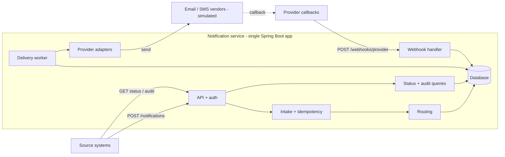
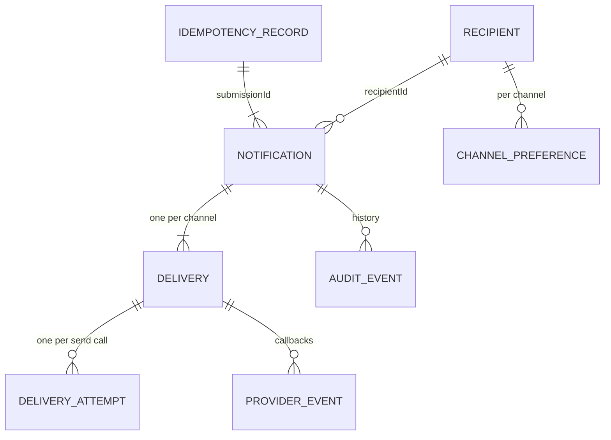
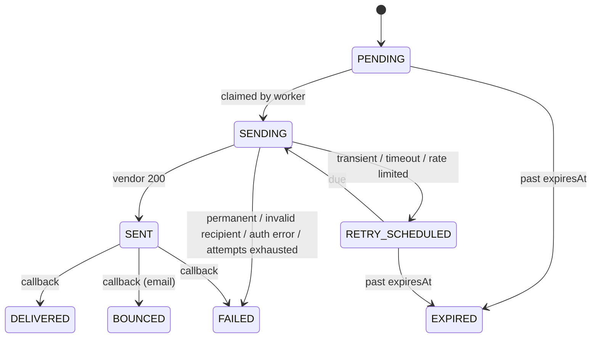
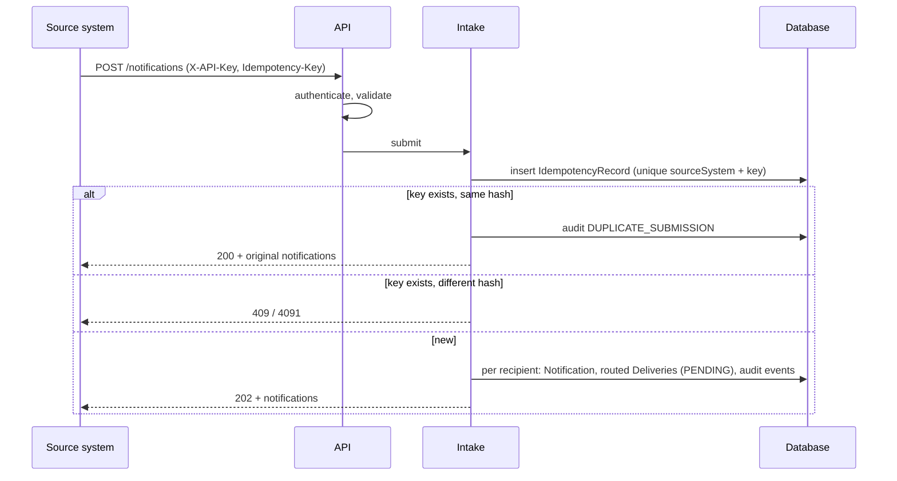
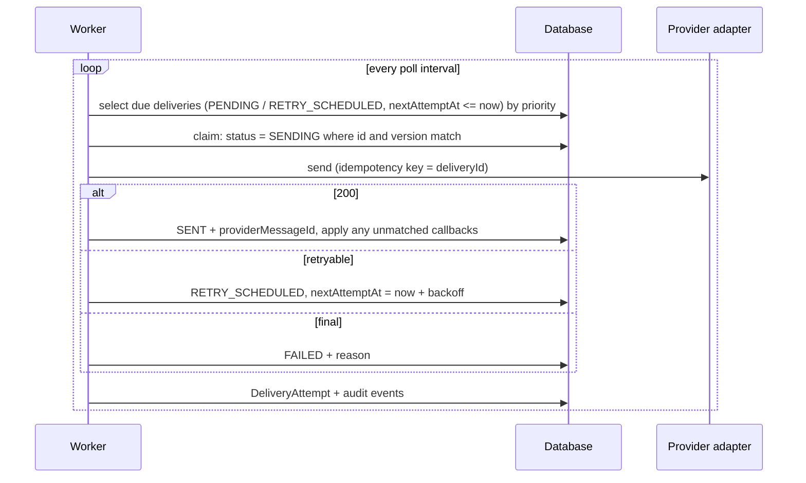

# Architecture

Notification Management Service: accepts notification requests from source systems, routes each recipient to channels, delivers asynchronously through providers, and tracks status through provider callbacks.

Decisions: `docs/adr/`. Assumptions: `docs/ambiguity-log.md`. Requirement IDs: `docs/requirements.md`.

## Components



| Component | Responsibility |
|---|---|
| API + auth | REST endpoints, validation, API-key and webhook-token auth, error mapping |
| Intake | Idempotency check, split request into one notification per recipient, persist |
| Routing | Resolve channels per recipient from request, preferences, and policy |
| Delivery worker | Claim due deliveries, call provider, classify result, schedule retries, expire |
| Provider adapters | One per channel: send call, error classification, callback event mapping |
| Webhook handler | Authenticate callback, dedupe, apply final status |
| Status + audit | Read models; overall status derived on read |
| Directory | Seeded recipients, contact addresses, channel preferences |

## API

All endpoints are under `/api/v1`. Callers authenticate with `X-API-Key` (ADR-0001). A source system can only read its own notifications.

| Method | Path | Purpose |
|---|---|---|
| POST | `/notifications` | Submit a notification for 1..100 recipients |
| GET | `/notifications/{id}` | Status of one notification (one recipient) |
| GET | `/notifications/{id}/audit` | Audit history of one notification |
| POST | `/webhooks/{provider}` | Provider delivery callbacks (`X-Webhook-Token`) |
| GET | `/actuator/health`, `/actuator/prometheus` | Operations |

### Submit

Headers: `X-API-Key` (required), `Idempotency-Key` (required).

```json
{
  "eventId": "evt-778",
  "type": "FRAUD_ALERT",
  "severity": "CRITICAL",
  "priority": "HIGH",
  "recipients": ["user1", "user2"],
  "channels": ["EMAIL"],
  "subject": "Suspicious login",
  "body": "We noticed a login from a new device.",
  "scheduledAt": null,
  "expiresAt": "2026-10-21T10:00:00Z"
}
```

- `channels` is optional. When present it applies to every recipient; when absent each recipient's enabled channels are used. Different channels for different recipients means separate requests.
- One notification is created per recipient. All notifications from one request share an internal `submissionId` (not exposed).
- `202` on a new submission, `200` on an idempotent replay (same key, same payload) with the same body.

```json
{
  "notifications": [
    { "recipientId": "user1", "notificationId": "6f1c...", "status": "ACCEPTED" },
    { "recipientId": "user2", "notificationId": "a83d...", "status": "ACCEPTED" }
  ]
}
```

### Status

```json
{
  "notificationId": "6f1c...",
  "recipientId": "user1",
  "eventId": "evt-778",
  "type": "FRAUD_ALERT",
  "severity": "CRITICAL",
  "overallStatus": "PARTIALLY_DELIVERED",
  "duplicateSubmissions": 1,
  "createdAt": "...", "scheduledAt": null, "expiresAt": "...",
  "deliveries": [
    { "channel": "EMAIL", "status": "DELIVERED", "attempts": 2, "sentAt": "...", "finalizedAt": "..." },
    { "channel": "SMS", "status": "FAILED", "reason": "INVALID_RECIPIENT", "attempts": 1, "finalizedAt": "..." }
  ]
}
```

### Audit

```json
{
  "events": [
    { "at": "...", "type": "ACCEPTED" },
    { "at": "...", "type": "ROUTED", "channel": "SMS", "detail": "added: severity CRITICAL" },
    { "at": "...", "type": "ATTEMPT_FAILED", "channel": "EMAIL", "detail": "TRANSIENT, attempt 1" },
    { "at": "...", "type": "RETRY_SCHEDULED", "channel": "EMAIL", "detail": "in 2s" },
    { "at": "...", "type": "DUPLICATE_SUBMISSION", "detail": "same Idempotency-Key; original returned" },
    { "at": "...", "type": "DELIVERED", "channel": "EMAIL" }
  ]
}
```

### Provider callbacks

Each provider adapter owns its payload format and the mapping to our statuses. Simulated formats follow the shape of common vendors.

`POST /webhooks/email` (batched, SendGrid-style):

```json
[
  { "eventId": "e-01", "messageId": "em-123", "event": "delivered", "timestamp": "..." },
  { "eventId": "e-02", "messageId": "em-456", "event": "bounce", "reason": "mailbox unavailable", "timestamp": "..." }
]
```

`POST /webhooks/sms` (single event, Twilio-style; dedupe key is `messageSid` + `messageStatus`):

```json
{ "messageSid": "SM-789", "messageStatus": "undelivered", "errorCode": "30003", "timestamp": "..." }
```

Response: `200` with no body for processed, duplicate, ignored, and unmatched events, so vendors do not retry them. Vendor free-text reasons are mapped to reason codes; raw text is not stored because it can contain addresses.

### Errors

Every error, including authentication failures raised before any controller, uses one body (`Content-Type: application/problem+json`; all RFC 9457 members are optional, so this stays compliant):

```json
{
  "traceId": "8f3c2a1b9d",
  "errors": [
    { "code": 4001, "field": "Idempotency-Key", "message": "Required header is missing" },
    { "code": 4004, "field": "recipients[2]", "message": "Must not be blank" }
  ]
}
```

- All validation errors are returned together.
- Submitted values are never echoed back.
- `code` is a stable contract shared across subsystems; `message` may change.

| Code | HTTP | Meaning |
|---|---|---|
| 4001 | 400 | Required header missing |
| 4002 | 400 | Malformed JSON |
| 4003 | 400 | Invalid field value or type |
| 4004 | 400 | Required field missing |
| 4005 | 400 | Too many recipients (max 100) |
| 4011 | 401 | API key or webhook token missing |
| 4012 | 401 | API key or webhook token invalid (expired and revoked are deliberately indistinguishable) |
| 4041 | 404 | Notification not found (also returned for another source system's notification) |
| 4091 | 409 | Idempotency key reused with a different payload |
| 4092 | 409 | Same idempotency key is still being processed |
| 4151 | 415 | Unsupported content type |
| 4221 | 422 | `expiresAt` is in the past |
| 4222 | 422 | `scheduledAt` is after `expiresAt` |
| 4223 | 422 | Unknown recipient (whole request rejected, every unknown recipient listed) |
| 5000 | 500 | Internal error (no detail, `traceId` only) |

## Data model



| Entity | Key fields | Notes |
|---|---|---|
| `IdempotencyRecord` | `sourceSystem`, `idempotencyKey` (unique together), `requestHash`, `submissionId`, `expiresAt` | Separate table so keys can expire (7 days) and be purged |
| `Notification` | `id`, `submissionId`, `sourceSystem`, `eventId`, `type`, `severity`, `priority`, `recipientId`, `subject`, `body`, `scheduledAt`, `expiresAt`, `createdAt` | One recipient. Overall status is derived, never stored |
| `Delivery` | `id`, `notificationId`, `channel` (unique together), `status`, `attemptCount`, `nextAttemptAt`, `claimedAt`, `providerMessageId`, `failureReason`, `sentAt`, `finalizedAt`, `version` | Unit of work for the worker. `version` for optimistic locking |
| `DeliveryAttempt` | `deliveryId`, `attemptNo` (unique together), `outcome`, `errorCategory`, `providerCode`, `startedAt`, `durationMs` | One row per send call; history is never overwritten |
| `ProviderEvent` | `provider`, `eventKey` (unique together), `providerMessageId`, `rawStatus`, `mappedStatus`, `matched`, `receivedAt` | Callback log for dedupe and late matching |
| `AuditEvent` | `notificationId`, `deliveryId`, `type`, `detail`, `occurredAt` | Append-only. No message content or contact details |
| `Recipient` | `id`, `email`, `phone` | Seeded directory |
| `ChannelPreference` | `recipientId`, `channel`, `enabled` | Seeded; disabled = opted out |

API keys and webhook tokens are configuration, not tables (ADR-0001).

## Routing

Resolved per notification (one recipient):

1. Candidates: request `channels` if given, else the recipient's enabled channels.
2. Remove channels the recipient opted out of, and channels with no contact address.
3. Apply policy from config, e.g. `CRITICAL` adds `SMS`. In greenfield an opt-out always wins over policy (revisited in the ambiguous scenario, A-30).
4. Each remaining channel becomes a `Delivery`. Every add and remove is audited with a reason.
5. No channel left: no deliveries, overall status `NOT_ROUTED`.

## Delivery lifecycle

Two-phase: a vendor `200` means accepted (`SENT`); the final outcome arrives by callback (ADR-0003).



- `SENT` with no callback stays `SENT` indefinitely. That is the honest state.
- After `SENT` nothing is resent; the vendor owns its own retries.
- Final states never change. Late or duplicate callbacks are ignored and audited.

### Failure classification (send call)

| Category | Example | Action |
|---|---|---|
| `TRANSIENT` | 5xx, connection reset | Retry with backoff |
| `TIMEOUT` | No response in time | Retry with backoff; same provider idempotency key (`deliveryId`) |
| `RATE_LIMITED` | 429 | Retry after `Retry-After`, else backoff |
| `PERMANENT_REJECTION` | Vendor refuses content | `FAILED` |
| `INVALID_RECIPIENT` | Bad address or number | `FAILED` |
| `AUTH_ERROR` | Vendor rejects our credentials | `FAILED`, error log, metric (config problem, not delivery problem) |

Retries: max 4 attempts (configurable), exponential backoff with full jitter, never scheduled past `expiresAt`.

### Overall status (derived on read)

| Deliveries | `overallStatus` |
|---|---|
| Before `scheduledAt` | `SCHEDULED` |
| Any `PENDING`, `SENDING`, `RETRY_SCHEDULED` | `IN_PROGRESS` |
| Otherwise any `SENT` | `AWAITING_CONFIRMATION` |
| All `DELIVERED` | `DELIVERED` |
| Some `DELIVERED`, rest failed, bounced, or expired | `PARTIALLY_DELIVERED` |
| None delivered, all `EXPIRED` | `EXPIRED` |
| None delivered, otherwise | `FAILED` |
| No deliveries | `NOT_ROUTED` |

"Delivered" means every routed channel was delivered, not "recipient reached on some channel" (A-22).

## Control flow

### Submit



One transaction per submission: the idempotency record and all notifications commit together or not at all.

### Deliver



- Claiming is a conditional update on `version`, so two workers can never send the same delivery.
- A delivery stuck in `SENDING` longer than the lease (crash mid-send) becomes claimable again. The resend reuses the same provider idempotency key.

### Callback

```mermaid
sequenceDiagram
    participant V as Vendor
    participant H as Webhook handler
    participant D as Database
    V->>H: POST /webhooks/{provider} (X-Webhook-Token)
    H->>H: authenticate; adapter maps vendor event to our status
    H->>D: insert ProviderEvent (unique provider + eventKey)
    alt duplicate event
        H-->>V: 200 (ignored)
    else delivery found and SENT
        H->>D: final status + finalizedAt + audit
        H-->>V: 200
    else delivery not found yet
        H->>D: keep ProviderEvent unmatched (applied when SENT commits)
        H-->>V: 200
    end
```

Unmatched events cover the race where a vendor calls back before our `SENT` write commits.

## Security

- Source systems: hashed, rotatable API keys; `sourceSystem` comes from the key, never the body (ADR-0001).
- Webhooks: shared secret token per provider in `X-Webhook-Token`, checked the same way. Production: verify each vendor's own signature (ADR-0003).
- Tenant isolation: reads are scoped to the caller's source system; other ids return 404.
- Input limits: max 100 recipients, bounded `subject` and `body` length, enum validation, request size limit.
- Sensitive data: message content and contact details never appear in logs, audit events, or error bodies. Audit and logs reference ids only.
- Secrets come from environment variables; nothing secret is committed.
- Actuator exposes only `health`, `info`, `prometheus`. The H2 console is off outside the `dev` profile.

## Operations

| Signal | Detail |
|---|---|
| Trace id | Generated per request (or taken from `traceparent`), in MDC, logs, `X-Trace-Id` response header, and error bodies |
| Logs | Structured JSON; ids and outcome categories only |
| Health | `/actuator/health` (database, worker liveness) |
| Metrics | `nms.notifications.accepted`, `nms.deliveries.outcome{channel,status}`, `nms.delivery.attempts{channel,category}`, `nms.deliveries.due` (backlog gauge), `nms.webhook.events{provider,result}`, `nms.auth.failures` |

What to alert on:
- `AUTH_ERROR` from a provider: our credentials are wrong; every delivery on that channel will fail.
- Growing `nms.deliveries.due`: workers are not keeping up or a provider is down.
- Spike in unmatched or rejected webhook events: misconfiguration or forged callbacks.

## Scaling path (not built)

| Concern | Prototype | Production |
|---|---|---|
| Database | H2 | PostgreSQL |
| Work claiming | Conditional update on `version` | `SELECT ... FOR UPDATE SKIP LOCKED`, or a broker (Kafka/SQS) with the database as outbox |
| Throughput | One instance, worker thread pool | Horizontal instances; per-channel worker pools |
| Provider limits | Retry on 429 | Token bucket per provider |
| Auth | Hashed API keys in config | HMAC request signing or JWT; secrets manager |
| Retention | Idempotency purge job | Partitioned audit tables, archival |

## Out of scope

Cancel, list/search, preferences API, templates and localization, engagement events (open/click), quiet hours, bulk sends above 100 recipients, real vendor integrations.
