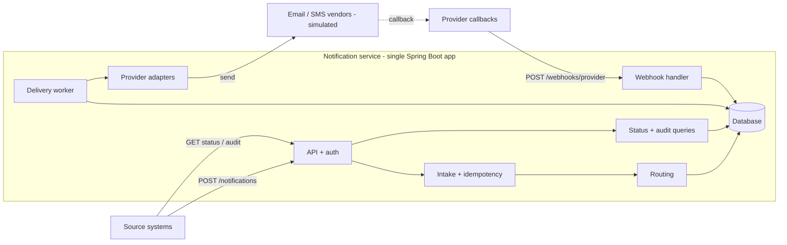

# Architecture

Notification Management Service: accepts notification requests from source systems, routes each recipient to channels, delivers asynchronously through providers, and tracks status through provider callbacks.

Decisions: `docs/adr/`. Assumptions: `docs/ambiguity-log.md`. Requirement IDs: `docs/requirements.md`.

## Components



| Component | Responsibility |
|---|---|
| API + auth | REST endpoints, validation, API-key and webhook-token auth, error mapping |
| Intake | Idempotency check, split request into one notification per recipient, persist |
| Routing | Resolve channels per recipient from request, preferences, and policy |
| Delivery worker | Claim due deliveries, call provider, classify result, schedule retries, expire |
| Provider adapters | One per channel: send call, error classification, callback event mapping |
| Webhook handler | Authenticate callback, dedupe, apply final status |
| Status + audit | Read models; overall status derived on read |
| Directory | Seeded recipients, contact addresses, channel preferences |

## API

All endpoints are under `/api/v1`. Callers authenticate with `X-API-Key` (ADR-0001). A source system can only read its own notifications.

| Method | Path | Purpose |
|---|---|---|
| POST | `/notifications` | Submit a notification for 1..100 recipients |
| GET | `/notifications/{id}` | Status of one notification (one recipient) |
| GET | `/notifications/{id}/audit` | Audit history of one notification |
| POST | `/webhooks/{provider}` | Provider delivery callbacks (`X-Webhook-Token`) |
| GET | `/actuator/health`, `/actuator/prometheus` | Operations |

### Submit

Headers: `X-API-Key` (required), `Idempotency-Key` (required).

```json
{
  "eventId": "evt-778",
  "type": "FRAUD_ALERT",
  "severity": "CRITICAL",
  "priority": "HIGH",
  "recipients": ["user1", "user2"],
  "channels": ["EMAIL"],
  "subject": "Suspicious login",
  "body": "We noticed a login from a new device.",
  "scheduledAt": null,
  "expiresAt": "2026-10-21T10:00:00Z"
}
```

- `channels` is optional. When present it applies to every recipient; when absent each recipient's enabled channels are used. Different channels for different recipients means separate requests.
- One notification is created per recipient. All notifications from one request share an internal `submissionId` (not exposed).
- `202` on a new submission, `200` on an idempotent replay (same key, same payload) with the same body.

```json
{
  "notifications": [
    { "recipientId": "user1", "notificationId": "6f1c...", "status": "ACCEPTED" },
    { "recipientId": "user2", "notificationId": "a83d...", "status": "ACCEPTED" }
  ]
}
```

### Status

```json
{
  "notificationId": "6f1c...",
  "recipientId": "user1",
  "eventId": "evt-778",
  "type": "FRAUD_ALERT",
  "severity": "CRITICAL",
  "overallStatus": "PARTIALLY_DELIVERED",
  "duplicateSubmissions": 1,
  "createdAt": "...", "scheduledAt": null, "expiresAt": "...",
  "deliveries": [
    { "channel": "EMAIL", "status": "DELIVERED", "attempts": 2, "sentAt": "...", "finalizedAt": "..." },
    { "channel": "SMS", "status": "FAILED", "reason": "INVALID_RECIPIENT", "attempts": 1, "finalizedAt": "..." }
  ]
}
```

### Audit

```json
{
  "events": [
    { "at": "...", "type": "ACCEPTED" },
    { "at": "...", "type": "ROUTED", "channel": "SMS", "detail": "added: severity CRITICAL" },
    { "at": "...", "type": "ATTEMPT_FAILED", "channel": "EMAIL", "detail": "TRANSIENT, attempt 1" },
    { "at": "...", "type": "RETRY_SCHEDULED", "channel": "EMAIL", "detail": "in 2s" },
    { "at": "...", "type": "DUPLICATE_SUBMISSION", "detail": "same Idempotency-Key; original returned" },
    { "at": "...", "type": "DELIVERED", "channel": "EMAIL" }
  ]
}
```

### Errors

Every error, including authentication failures raised before any controller, uses one body (`Content-Type: application/problem+json`; all RFC 9457 members are optional, so this stays compliant):

```json
{
  "traceId": "8f3c2a1b9d",
  "errors": [
    { "code": 4001, "field": "Idempotency-Key", "message": "Required header is missing" },
    { "code": 4004, "field": "recipients[2]", "message": "Must not be blank" }
  ]
}
```

- All validation errors are returned together.
- Submitted values are never echoed back.
- `code` is a stable contract shared across subsystems; `message` may change.

| Code | HTTP | Meaning |
|---|---|---|
| 4001 | 400 | Required header missing |
| 4002 | 400 | Malformed JSON |
| 4003 | 400 | Invalid field value or type |
| 4004 | 400 | Required field missing |
| 4005 | 400 | Too many recipients (max 100) |
| 4011 | 401 | API key or webhook token missing |
| 4012 | 401 | API key or webhook token invalid (expired and revoked are deliberately indistinguishable) |
| 4041 | 404 | Notification not found (also returned for another source system's notification) |
| 4091 | 409 | Idempotency key reused with a different payload |
| 4092 | 409 | Same idempotency key is still being processed |
| 4151 | 415 | Unsupported content type |
| 4221 | 422 | `expiresAt` is in the past |
| 4222 | 422 | `scheduledAt` is after `expiresAt` |
| 4223 | 422 | Unknown recipient (whole request rejected, every unknown recipient listed) |
| 5000 | 500 | Internal error (no detail, `traceId` only) |
